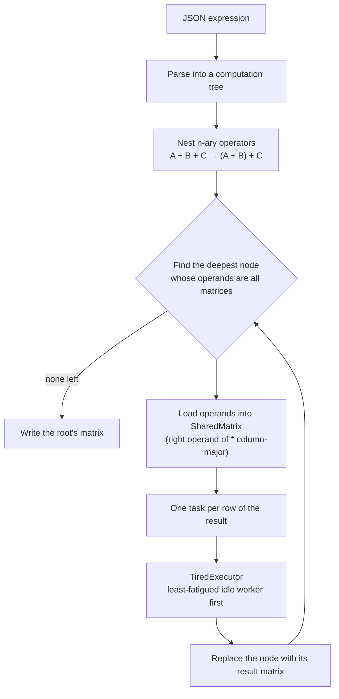

# Parallel Matrix Engine

Evaluates matrix expressions — addition, multiplication, negation, transpose, nested to any depth — written as JSON trees. Each operation is split into one task per row and run on a hand-built thread pool that always hands the next task to its **least "fatigued" worker**. Java 21, built directly on `java.util.concurrent` primitives.

[](https://github.com/AsafCo2211/SPL-Assignment2/actions/workflows/ci.yml)


Built for the *Systems Programming* course at Ben-Gurion University.

```json
{ "operator": "*", "operands": [
    { "operator": "+", "operands": [ [[1, 0], [0, 1]], [[1, 1], [1, 1]], [[2, 0], [0, 2]], [[0, 3], [3, 0]] ] },
    { "operator": "T", "operands": [
        { "operator": "*", "operands": [ [[1, 2], [3, 4]], [[1, 0], [0, 1]], [[2, 0], [0, 2]] ] } ] }
] }
```

```bash
$ java -jar target/parallel-matrix-engine-1.0.jar 4 examples/inputs/nested-operators.json out.json
$ cat out.json
{ "result" : [ [ 24.0, 56.0 ], [ 24.0, 56.0 ] ] }
```

Operators: `+` add, `*` multiply, `-` negate, `T` transpose. `+` and `*` take two or more operands. Invalid input — e.g. adding matrices of different shapes — produces `{ "error": "..." }` instead of a result.

---

## How it works



The expression is reduced bottom-up, one operation at a time; **parallelism happens inside each operation**, across rows. For a product, the right operand is stored column by column, so each row task computes a row of the result as dot products of contiguous vectors.

### Concurrency design

- **`SharedVector`** guards each row or column with its own `ReentrantReadWriteLock`. Tasks only read the other operand, so many workers hold read locks on the same column at once; a row's result is computed into a temporary array and the row is write-locked only to swap it in.
- **`TiredThread`** is a worker with a fatigue factor (0.5–1.5) and a one-slot hand-off queue. Its *fatigue* is factor × time spent working. Shutdown is a poison-pill task, so a worker finishes what it holds before exiting.
- **`TiredExecutor`** keeps idle workers in a `PriorityBlockingQueue` ordered by fatigue. `submit` takes the least-fatigued worker — blocking while all are busy — and the worker re-enters the queue when its task ends. `submitAll` waits on a counter until every task of an operation has finished, then **rethrows the first task failure**, if any.

The worker report after a run shows the effect — workers that tire faster get less work:

```
Worker #0 [FF=0.71]:  busy    59.40 ms   idle    76.14 ms   fatigue    42.26
Worker #1 [FF=0.92]:  busy    38.80 ms   idle    94.97 ms   fatigue    35.61
Worker #2 [FF=0.65]:  busy    55.25 ms   idle    77.40 ms   fatigue    35.78
Worker #3 [FF=1.24]:  busy    36.75 ms   idle    96.02 ms   fatigue    45.57
```

## Performance

Multiplying two random 800×800 matrices on GitHub's 4-core `ubuntu-latest` runner (median of 5 runs, after a warm-up). This runs in CI on every push — see the *Thread-scaling benchmark* job.

| threads | median time | speed-up |
|--------:|------------:|---------:|
| 1 | 573 ms | 1.00× |
| 2 | 294 ms | 1.95× |
| 4 | 194 ms | 2.95× |
| 8 | 188 ms | 3.05× |

Close to linear at two threads, about 3× at four, and flat beyond the core count — more threads than cores only add scheduling overhead. The benchmark also checks that every thread count produces a bit-for-bit identical result.

```bash
java -cp target/parallel-matrix-engine-1.0.jar spl.lae.Benchmark 800 5 1 2 4 8   # size, runs, thread counts
```

## Correctness

[`scripts/check-examples.sh`](scripts/check-examples.sh) runs every file in [`examples/inputs`](examples/inputs) and compares the result with [`examples/expected`](examples/expected). Those expected outputs come from a **separate, sequential implementation** in [`InputGenerator`](src/main/java/spl/lae/InputGenerator.java) (or, for the two nested examples, numpy) — so a match checks the parallel engine against an independent answer, not against itself. Files in [`examples/invalid`](examples/invalid) must produce an error.

### Two wrong answers found while preparing this repo

Both bugs returned a plausible-looking matrix instead of failing, and neither was caught by the original tests:

1. **Failed tasks were swallowed.** Workers catch exceptions so a bad task can't kill the thread — but nothing passed the failure on. Adding a 2×2 to a 2×3 matrix (a mismatch only detected inside the row tasks) printed to stderr and returned the *unchanged left operand* as the result. One existing test even asserted that this case returns normally. `submitAll` now rethrows the first failure.
2. **Three-operand operations below the root lost operands.** `A + B + C` was rewritten as `(A + B) + C` only at the root, and the engine reads two operands per node, so `-(1 + 10 + 100)` came out as `-11`. Nesting now covers the whole tree.

## Build and run

**Requirements:** Java 21 and Maven.

```bash
mvn package                         # builds and runs the 74 unit tests
java -jar target/parallel-matrix-engine-1.0.jar <threads> <input.json> <output.json>
scripts/check-examples.sh           # end-to-end check of every example
```

Generate a new random test case — an input and its sequentially computed expected output:

```bash
java -cp target/parallel-matrix-engine-1.0.jar spl.lae.InputGenerator
```

## Project layout

```
src/main/java/
  memory/       SharedVector, SharedMatrix — locked row/column storage
  scheduling/   TiredThread, TiredExecutor — fatigue-aware thread pool
  parser/       JSON → computation tree, output writer
  spl/lae/      LinearAlgebraEngine (Main), Benchmark, InputGenerator
examples/       inputs/, expected/, invalid/
scripts/        check-examples.sh, compare_results.py
```

## Limitations

- **One operation at a time.** Independent subtrees (the two sides of `(A·B) + (C·D)`) are evaluated one after the other; only the rows within an operation run in parallel.
- **A read lock per column read.** Each multiply task locks every column it reads. It's safe and simple, but acquiring shared read locks from many threads costs throughput.
- **Random fatigue factors.** Each worker's factor is drawn at start-up, so the distribution of work differs between runs (the result does not).
- **Dense `double` matrices in memory**, read whole from JSON.
